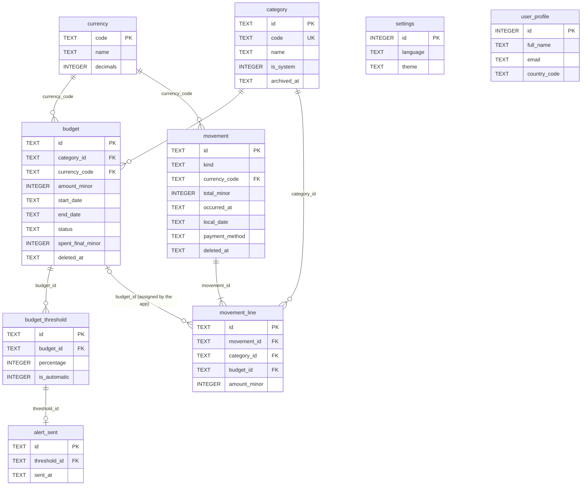

# App de presupuestos — Modelo entidad-relación MVP (Fase 1)

Nov 6, 2026 · @Natalia

El modelo tiene 9 tablas en SQLite local. Cada línea de movimiento guarda su categoría y su presupuesto; el presupuesto lo asigna la app automáticamente por categoría, moneda y fecha local (RN-17, RN-39).

## Diagrama entidad-relación



`currency` y `category` son catálogos que comparten presupuestos y movimientos; `settings` y `user_profile` son independientes (una fila cada una). Entre `movement_line` y `budget` sí hay llave, pero la asigna la app según categoría, moneda y `local_date`.

## Diccionario de datos

Todos los `id` son UUID en texto. Los montos son enteros en unidad menor. Las fechas de presupuesto son texto `YYYY-MM-DD`.

**currency** — monedas soportadas (catálogo precargado)

| Campo | Tipo | Reglas |
| --- | --- | --- |
| code | TEXT PK | `COP`, `USD`, `EUR` |
| name | TEXT | Nombre visible |
| decimals | INTEGER | COP 0, USD 2, EUR 2 (RN-32) |

**category** — categorías del sistema y personalizadas

| Campo | Tipo | Reglas |
| --- | --- | --- |
| id | TEXT PK |  |
| code | TEXT UNIQUE, nulo | Solo categorías del sistema; se usa para traducir el nombre (RN-34) |
| name | TEXT, nulo | Solo personalizadas; único sin distinguir mayúsculas (RN-35) |
| icon | TEXT | Nombre del ícono |
| color | TEXT | Color en hexadecimal |
| is\_system | INTEGER 0/1 | 1 = no se borra ni se renombra |
| archived\_at | TEXT, nulo | Fecha y hora de archivo (RN-36) |
| created\_at, updated\_at | TEXT | Fecha y hora ISO |

**budget** — presupuestos

| Campo | Tipo | Reglas |
| --- | --- | --- |
| id | TEXT PK |  |
| category\_id | TEXT FK → category | Obligatorio |
| currency\_code | TEXT FK → currency | No editable (RN-02) |
| amount\_minor | INTEGER | Mayor que 0 |
| start\_date, end\_date | TEXT | `start_date <= end_date`; sin solapamiento (RN-03) |
| status | TEXT | `ACTIVE` o `CLOSED`; “en gracia” se calcula con la fecha (RN-05) |
| spent\_final\_minor | INTEGER, nulo | Gastado congelado al cerrar |
| closed\_at | TEXT, nulo | Fecha y hora de cierre |
| created\_at, updated\_at | TEXT |  |
| deleted\_at | TEXT, nulo | Borrado lógico (RN-10) |

**budget\_threshold** — umbrales de cada presupuesto

| Campo | Tipo | Reglas |
| --- | --- | --- |
| id | TEXT PK |  |
| budget\_id | TEXT FK → budget |  |
| percentage | INTEGER | 1 a 100; único por presupuesto (RN-24) |
| is\_automatic | INTEGER 0/1 | 1 = alerta automática del 100% (RN-25) |

**alert\_sent** — umbrales ya notificados

| Campo | Tipo | Reglas |
| --- | --- | --- |
| id | TEXT PK |  |
| threshold\_id | TEXT FK → budget\_threshold, UNIQUE | Máximo un registro por umbral (RN-27) |
| sent\_at | TEXT | Fecha y hora del envío |

**movement** — cabecera de gastos, reembolsos e ingresos

| Campo | Tipo | Reglas |
| --- | --- | --- |
| id | TEXT PK |  |
| kind | TEXT | `EXPENSE`, `REFUND`, `INCOME` (RN-12) |
| currency\_code | TEXT FK → currency |  |
| total\_minor | INTEGER | Mayor que 0; igual a la suma de sus líneas (RN-14) |
| occurred\_at | TEXT | Fecha y hora local con desfase, p. ej. `2026-11-06T23:10:00-05:00` (RN-15) |
| local\_date | TEXT | `YYYY-MM-DD` tomado de `occurred_at`; se usa para asignar presupuestos |
| payment\_method | TEXT | `CASH`, `DEBIT_CARD`, `CREDIT_CARD`, `TRANSFER`, `OTHER` (RN-19) |
| note | TEXT, nulo |  |
| created\_at, updated\_at | TEXT |  |
| deleted\_at | TEXT, nulo | Borrado lógico (RN-21) |

**movement\_line** — reparto del movimiento por categoría

| Campo | Tipo | Reglas |
| --- | --- | --- |
| id | TEXT PK |  |
| movement\_id | TEXT FK → movement |  |
| category\_id | TEXT FK → category |  |
| budget\_id | TEXT FK → budget, nulo | Lo asigna la app, nunca el usuario; nulo = sin presupuesto (RN-17, RN-39) |
| amount\_minor | INTEGER | Mayor que 0 |

**settings** — configuración de la app (una sola fila)

| Campo | Tipo | Reglas |
| --- | --- | --- |
| id | INTEGER PK | Siempre 1 |
| language | TEXT | `es` o `en` |
| theme | TEXT | `LIGHT`, `DARK`, `SYSTEM` |
| updated\_at | TEXT |  |

**user\_profile** — perfil del usuario del dispositivo (una sola fila, RN-42)

| Campo | Tipo | Reglas |
| --- | --- | --- |
| id | INTEGER PK | Siempre 1 |
| full\_name | TEXT | No vacío |
| email | TEXT | Formato válido; no se verifica |
| country\_code | TEXT | ISO 3166-1 alfa-2 (por ejemplo `CO`) |
| created\_at | TEXT |  |
| updated\_at | TEXT |  |

El PIN **no** está en esta tabla: su hash con sal vive en el almacenamiento seguro del sistema (RN-43). Como en iOS ese almacenamiento (Keychain) puede sobrevivir a una reinstalación aunque la base se borre, al registrarse se descarta cualquier hash anterior.

## Restricciones, índices y triggers

Las reglas que pueden romper la integridad se protegen también en SQLite; el dominio valida antes para mostrar mensajes claros.

```sql
-- CHECKs principales
CHECK (amount_minor > 0)                                 -- budget, movement_line
CHECK (total_minor > 0)                                  -- movement
CHECK (start_date <= end_date)                           -- budget
CHECK (status IN ('ACTIVE','CLOSED'))                    -- budget
CHECK (percentage BETWEEN 1 AND 100)                     -- budget_threshold
CHECK (kind IN ('EXPENSE','REFUND','INCOME'))            -- movement
CHECK (payment_method IN ('CASH','DEBIT_CARD','CREDIT_CARD','TRANSFER','OTHER'))
CHECK (id = 1)                                           -- settings, user_profile

-- Unicidad
CREATE UNIQUE INDEX ux_threshold ON budget_threshold(budget_id, percentage);
CREATE UNIQUE INDEX ux_alert ON alert_sent(threshold_id);
CREATE UNIQUE INDEX ux_category_name ON category(lower(name)) WHERE name IS NOT NULL;

-- Consultas frecuentes
CREATE INDEX ix_budget_cat_dates ON budget(category_id, start_date, end_date);
CREATE INDEX ix_movement_date ON movement(local_date);
CREATE INDEX ix_line_movement ON movement_line(movement_id);
CREATE INDEX ix_line_category ON movement_line(category_id);
CREATE INDEX ix_line_budget ON movement_line(budget_id);

-- Sin solapamiento (RN-03); hay un trigger igual para UPDATE que excluye NEW.id
CREATE TRIGGER budget_no_overlap_ins BEFORE INSERT ON budget
WHEN EXISTS (
  SELECT 1 FROM budget
  WHERE category_id = NEW.category_id AND deleted_at IS NULL
    AND NEW.start_date <= end_date AND NEW.end_date >= start_date
)
BEGIN SELECT RAISE(ABORT, 'BUDGET_OVERLAP'); END;
```

Se validan solo en el dominio, dentro de la misma transacción de guardado:

- La suma de las líneas es igual a `total_minor` (RN-14).
- Máximo 3 umbrales configurables por presupuesto (RN-24).
- Fecha y hora no futura (RN-16) y máximo de 12 dígitos enteros (RN-20).
- No editar ni borrar movimientos que afecten presupuestos cerrados (RN-08, RN-18).
- Asignar y reasignar budget\_id de las líneas al guardar movimientos y al crear, editar fechas o borrar presupuestos (RN-39).

## Decisiones de diseño

- **Perfil sin `user_id` en el resto de tablas.** Hay un usuario por dispositivo, así que `user_profile` es una fila independiente. Si llega el backend, se agrega `user_id` con una migración.
- **PIN fuera de SQLite.** Evita dejar un secreto junto a los datos y que un respaldo lo exporte.
- **Presupuesto asignado por la app.** Cada línea guarda budget\_id, pero lo calcula la app buscando el presupuesto de su categoría y moneda cuyo rango contiene `local_date` (RN-17, RN-39). Así las consultas de uso son simples (WHERE budget\_id = ?) y un movimiento puede repartirse entre varios presupuestos o quedar sin ninguno.
- **Montos enteros.** `amount_minor` y `total_minor` evitan errores de redondeo; `currency.decimals` indica cómo convertir y mostrar.
- **Hora local con desfase.** `occurred_at` conserva cuándo ocurrió el movimiento y en qué zona horaria; `local_date` se guarda aparte para indexar y consultar rápido.
- **Estado “en gracia” calculado.** No se guarda: se deriva de `end_date` + 5 días (RN-05, RN-38). Solo el cierre se persiste, porque congela `spent_final_minor`.
- **Alerta del 100% como fila.** Se guarda como un umbral más con `is_automatic = 1`, para que la lógica de alertas sea una sola.
- **Preparado para fases futuras.** UUID, `created_at`, `updated_at` y `deleted_at` facilitan la sincronización con el backend. El grupo familiar agregará tablas de grupo y miembros sin cambiar las actuales.
- **Categoría nunca nula.** movement\_line.category\_id es obligatorio; los movimientos sin categoría van a la categoría del sistema SIN\_CLASIFICAR, que no admite presupuestos (RN-40). Así ninguna consulta necesita casos especiales con IS NULL para la categoría.
